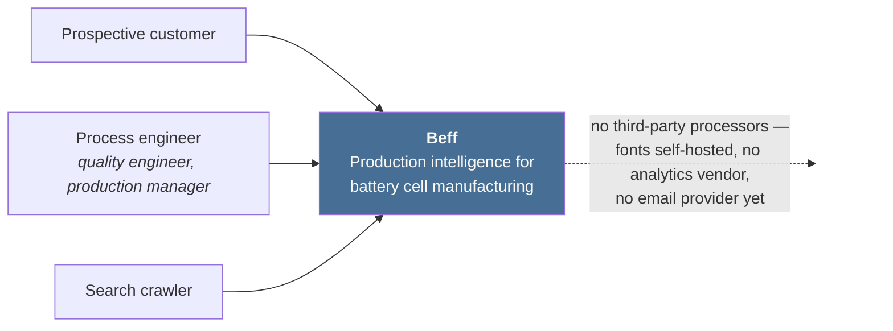
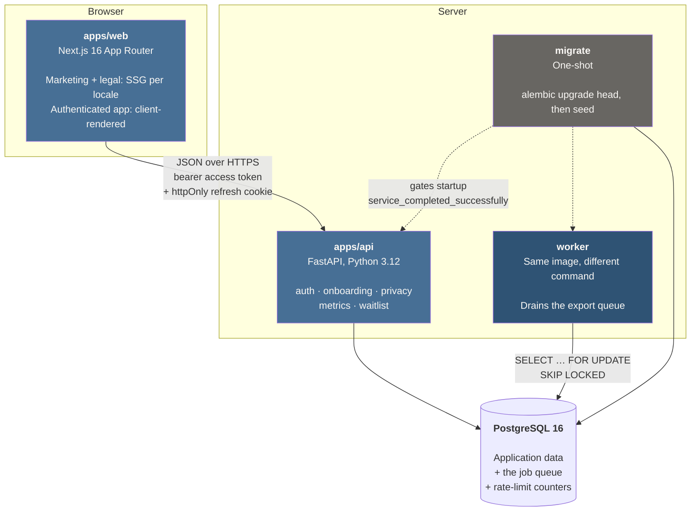

# Beff — Pre-Launch SaaS MVP

**Production intelligence for battery cell manufacturing.** See where yield is lost,
what it costs in scrap, and what it means for CO₂ per kWh.

> Built as a technical take-home for Beff GmbH (Stuttgart). This is an **assignment
> build**, not an official Beff product — the domain is modelled on the problem space
> the company works in.

🚧 **In progress.** Foundations are complete and verified; feature work is tracked on
a Linear board, with a verification command defined per checkpoint.

---

## Quickstart

```bash
cp .env.example .env
docker compose up            # postgres + api + web
```

- Web → <http://localhost:3000>
- API docs → <http://localhost:8000/docs>
- OpenAPI schema → <http://localhost:8000/openapi.json>

**Sign in without registering.** The seed creates a demo account with onboarding
already complete and sixty batches of production data behind it:

```
demo@beff.example / beff-demo-password
```

```bash
cd apps/api && uv run alembic upgrade head && uv run python -m beff.seed
```

Every seeded figure sits inside the ranges in the domain glossary — first-pass yield
walks 64% to 74% across two months, which is what a pilot line actually looks like.
One process parameter is deliberately **out of spec**, because a dashboard where
everything is green never demonstrates that it can show a problem.

Running without Docker:

```bash
pnpm install && pnpm dev                         # frontend
cd apps/api && uv sync && uv run uvicorn beff.main:app --reload   # backend
```

---

## Architecture

### C4 level 1 — context

Who uses the system, and what it touches. Deliberately short: at pre-launch there
are no third-party processors, and that is itself a GDPR decision — every
external dependency is a data flow to justify in the privacy policy.



### C4 level 2 — containers



**The frontend never talks to the database, and the backend never renders HTML.**
That boundary is what makes the two independently deployable, and it is the
reason authenticated pages are client-rendered — see decision 3 below.

**There is no Redis.** The queue, the rate limiter and the application data all
live in one PostgreSQL. At pre-launch volume a second datastore is a thing to
run, deploy, monitor and back up, in exchange for capabilities a table already
provides.

| Layer    | Choice                                                                   |
| -------- | ------------------------------------------------------------------------ |
| Frontend | Next.js 16, React 19, TypeScript 5.9, Tailwind 4, shadcn/ui, React Query |
| Backend  | FastAPI, SQLAlchemy 2 (async), Alembic, Pydantic v2, Argon2id            |
| Database | PostgreSQL 16 — application data **and** the job queue                   |
| Testing  | pytest, Vitest, Testing Library, Playwright, axe-core, Storybook         |
| Tooling  | pnpm + Turborepo, uv, ruff, mypy strict, ESLint, GitHub Actions          |

**Why two apps rather than Next.js alone:** the brief requires NestJS or FastAPI, and
Next Route Handlers are neither. Full reasoning in [Design choices](#design-choices).

---

## Design choices

### Next.js **and** FastAPI, not Next.js alone

Next-only is genuinely the simpler option — one deployable, one language, no CORS, no
cross-service type drift. It is disqualified by one sentence in the brief: _"Use either
the NestJS or FastAPI framework."_ Route Handlers are neither.

Given a second service was required, FastAPI over NestJS because the job description
assigns Python specifically to "FastAPI for data services", and this is a data product.

Next.js then has to earn its place on the frontend rather than be assumed. It does, for
one measurable reason: the marketing surface is **statically generated**, so the
acquisition page ships as HTML with no JS-blocked content for crawlers. The build output
reports `/` as `○ (Static)` — verifiable, not asserted.

**Cost:** CORS with credentials, two toolchains in CI, and a contract that must be kept
in sync. That last one is handled by generating the TypeScript client from the backend's
OpenAPI schema, with a CI job that fails on drift.

### FastAPI owns authentication — and the consequence

Short-lived JWT in memory, httpOnly `SameSite` refresh cookie, **rotation with reuse
detection** (tokens carry a `family_id`; redeeming a spent token revokes the family, on
the assumption it was stolen).

The consequence is worth stating rather than hiding: **rotation and server-rendering
authenticated routes are incompatible.** If a Server Component redeemed the refresh
cookie during SSR while the browser also redeemed it, reuse detection would fire —
correctly — and log the user out. That is the normal case on page load, not a rare race.

So the marketing surface is static and the app surface is client-rendered with React
Query. That is the right trade anyway: dashboard data is per-user and refetched often,
which benefits far more from a query cache than from one server render.

### Postgres as the job queue — no Redis

Data export and the erasure sweep both need persistence, retries and idempotency. The
conventional reach is Redis, and the JD lists it.

A pre-launch product has no load to justify a second datastore. `SELECT … FOR UPDATE SKIP
LOCKED` gives an explicit state machine, idempotency, exponential backoff, a visibility
timeout and a dead-letter state — with one fewer service to run, deploy, secure and
monitor. It also lets a job be enqueued **inside the same transaction** as the state
change that triggers it, so a job can never reference a rolled-back row.

**Cost:** polling latency instead of push, and a throughput ceiling in the low thousands
per second. Both irrelevant here. Redis becomes correct above roughly 1k jobs/sec.

### Hybrid primary keys

"UUIDs everywhere" and "BIGINT everywhere" are both right, about different tables. The
question that actually has an answer is **"is this identifier ever visible to a client?"**

- **UUIDv7** for `users`, `export_jobs`, `dsar_requests` — exposed in URLs, so
  enumeration must be impossible. v7 rather than v4 because it is time-ordered and keeps
  index locality.
- **BIGINT IDENTITY** for `audit_events`, `metric_snapshots`, `consent_records` — never
  exposed, high write volume, and 8 bytes beats 16 in every index.

### Compose, not Kubernetes

A reviewer must be able to run this with one command. Two services and a database do not
justify ingress, manifests and a cluster, and reaching for them would read as
disproportionate tooling.

The app is nonetheless orchestrator-**ready** where it matters: liveness and readiness
are separate probes (`/healthz` deliberately touches no dependencies — restarting a
container because the database blipped makes an outage worse), config is env-only, and
the API is stateless.

### Colour is a data decision, not a taste one

The brand accent is deliberately kept away from `success` / `warning` / `danger`. In a
yield dashboard green means _in spec_ and red means _out of spec_; a green brand would
make every chart ambiguous. Chart palettes are colourblind-safe and never encode meaning
in hue alone.

---

## How I approached UI/UX intuitiveness

The user is a **process engineer, quality engineer or production manager** at a cell
manufacturer. They are technical, time-poor, and already drowning in spreadsheets. They
do not need to be impressed; they need to find the problem. Everything below follows
from that one sentence.

### The information architecture is a gate, not a document

The app is five surfaces — landing, auth, onboarding, dashboard, profile — and they are
declared in `apps/web/src/lib/navigation/surfaces.ts`. `surfaces.test.ts` **fails the
build** if a route exists that the IA does not name, if a named surface has no route, if
the authenticated navigation grows past two destinations, or if any surface nests more
than one level deep.

That gate exists because the alternative is well known: five screens built in sequence
each invent their own structure, and the product reads as five apps stapled together. A
written IA document would have drifted by the third screen.

The hierarchy is deliberately flat. There is no "Settings" tree, because the two things
a user actually changes about their account are their consent and their existence — and
both live on Profile, where the GDPR obligations are visible together rather than buried.

### The dashboard answers a question, in the order it is asked

A process engineer arrives with _where did yield go_. So: four headline figures first,
then the breakdown that answers "where", then the parameters against their spec windows.

Two decisions in the scrap breakdown are worth naming because they look like mistakes
until you know the domain:

- **It is never sorted by size.** Always process order — mixing through end-of-line test.
  A cell lost at formation has absorbed every upstream cost, so a bar's _position_ is
  economic information, and re-sorting destroys it.
- **Every bar is one neutral colour.** Colouring by severity would encode a quantity in
  hue, which fails for roughly one man in twelve — and `success`/`warning`/`danger` are
  reserved for _in spec_ versus _out of spec_, the most consequential distinction the
  product makes. Using them for "more scrap" would make the palette mean two different
  things on one screen.

The `Metric` component also **refuses to infer intent from direction**. Yield rising is
good news; scrap rising is not. The same arrow has to mean opposite things in two
adjacent tiles, so the caller states the intent and the component does not guess.

### The signature element is borrowed from the domain, not from SaaS

Every measurement is shown against its tolerance band — the in-spec window, the limits,
the target, and where the reading actually landed. It is the shape an engineer already
reads on a control chart or a calibration certificate.

It is also the clearest example of how accessibility was approached here. The drawing is
`aria-hidden`; a text readout carries the verdict in words, so a screen-reader user gets
the _conclusion_ ("out of spec, above the upper limit") rather than a description of a
picture. Out-of-spec is signalled three ways at once: position, a filled diamond instead
of a hairline, and the word itself.

### Every data surface ships four states

Loading, empty, error and partial are a type error to forget: `DataState` takes all four
or does not compile. Real production data is frequently incomplete, and three of the four
states are exactly what goes missing when they are left to each screen.

The loading state is a **live region**, not a silent shimmer — the wait is announced, and
so is what arrives. The empty state announces too, because it replaces that live region;
a screen-reader user would otherwise be left in silence. And empty is never rendered as
an error: a successful request with no rows is not a failure, and telling the user it is
teaches them to distrust every error the app shows.

### Destructive actions carry friction, never confusion

Account deletion asks the user to **type DELETE**, not to click a red button in a modal.
A confirmation dialog is dismissed by muscle memory; typing a word cannot be. The copy
states what is erased, what is retained and on what legal basis, and that the email
becomes free to register again.

### Forms fail the way the server says they failed

Validation messages come from the API's RFC 9457 Problem Details, keyed by a **stable
machine-readable code** rather than parsed out of English prose. That is what lets the
German locale show German errors without the backend knowing which language is on
screen. Errors are announced, read before the field's help text (the more urgent of the
two), and carry a glyph as well as colour.

Login deliberately does **not** say which half was wrong — that would turn the form into
an account-enumeration oracle, and the backend burns equivalent hashing time on the
missing-user path so the latency does not leak what the status code does not.

### German is a shipped locale, not a toggle

`de.ts` is typed against the English dictionary, so a missing translation is a **build
error**, not an English word appearing mid-sentence in production. The domain terms are
the ones a German engineer actually uses — Ausschuss, Kalandrieren, Formierung — not
translations of the English.

German runs roughly 30% longer, which is why CSS **logical properties** are a project
rule rather than a preference, and why the privacy page's table scrolls inside its own
container so the page body never scrolls sideways.

The privacy page keeps its German URL (`/datenschutz`) in both locales. Translating a
legal page's URL is how you end up with two of them and a broken link from the Impressum.

### Onboarding assumes it will be interrupted

Progress is persisted server-side after every step, so the **server owns which step you
are on**. A client that remembers its own position resumes correctly only on the device
that recorded it — and being interrupted mid-task is the normal case on a factory floor,
not an edge one.

Focus moves to the new step's heading on every navigation. Without it, focus stays on a
button that no longer exists and a screen reader announces nothing at all: the page
silently changed underneath the user.

## Accessibility

Target **WCAG 2.2 AA**. What is actually in place today, separated from what is not:

**In place and enforced:**

- `jsx-a11y` rules run as **errors**, not warnings, and were confirmed to fail on a
  deliberate probe — a linter that has never failed proves nothing. They caught two real
  defects while the cookie banner was being written.
- **Contrast is gated by test, not by eye.** `packages/tokens` proves every semantic
  text/surface pair clears 4.5:1 (3:1 for large text and UI). The first eyeballed palette
  failed: two pairs in light and the whole set in dark. The shipped values were _solved_
  against the floor, not chosen.
- **Colour-vision distance is gated too**, CIEDE2000 under deuteranopia and protanopia.
  The pairs that cannot clear the threshold are enumerated with their measured distances
  rather than waved through by a lowered floor, so a palette change that pushes a _new_
  pair below it fails the build and has to be argued for.
- **Charts ship a data-table alternative** — and the table is the authoritative rendering
  while the bars are `aria-hidden`, so the description cannot drift from the picture.
- Native HTML before ARIA throughout: `<button>`, `<label for>`, `<select>`, `<progress>`,
  `<details>`, `<figure>`. The theme switcher is a native `<select>` rather than a custom
  listbox, which buys keyboard navigation, type-ahead and a mobile picker for free.
- One focus treatment, defined once globally against a token proven to clear 3:1 on both
  surfaces.
- `prefers-reduced-motion` respected globally; only `transform` and `opacity` animate.

- **`axe-core` runs in a real browser** at WCAG 2.2 AA over the landing page in
  both locales, both legal pages, login, register, the cookie banner, dark mode
  and the 404. `best-practice` is deliberately excluded: it mixes genuine
  failures with stylistic opinion, and a gate that fires on opinion is one people
  learn to override. Dark mode gets its own pass because contrast is the one axe
  rule that depends on rendered colour.
- **Keyboard flows are asserted, which axe cannot do.** The skip link is the
  first thing `Tab` reaches and is visible when focused; the focus ring is never
  removed; the cookie banner can be answered and the locale switched without a
  mouse. That is the M4 gate — every flow completable keyboard-only — made
  executable.
- The suite runs against the **standalone server the Docker image actually
  executes**, not `next start`, which does not support that output mode.

**Not done, and not claimed:**

- **The manual screen-reader pass has not happened.** Automated tooling catches only
  30–50% of issues, so this is the half that matters. Without it, **this project does
  not claim WCAG 2.2 AA** — only that its automated gates pass. Stating it the other way
  round would be the kind of claim that gets found out by the first person who tries.
- Only Chromium. WebKit and mobile are on the documented cut list.
- The authenticated surfaces are not in the E2E suite — those need the stack up,
  and the suite is deliberately scoped to what runs without a database.
- No Storybook, so there is no per-state a11y assertion.

## GDPR

Three data subject rights, one of which is required by the brief twice — erasure is also
the "offboarding" it asks for.

| Right       | Article | Implementation                                                                                                                              |
| ----------- | ------- | ------------------------------------------------------------------------------------------------------------------------------------------- |
| Consent     | Art. 7  | Append-only records. There is no `update` method anywhere in the service **or its repository protocol** — the absence is the design         |
| Access      | Art. 15 | Queued export job; the document is JSON and excludes password hashes and any third party's data                                             |
| Portability | Art. 20 | The same export, self-describing and machine-readable, with `Decimal` values as strings so precision does not quietly change on the way out |
| Erasure     | Art. 17 | Sessions revoked, exports deleted, consent pseudonymised, account soft-deleted with every identifying column scrubbed in the same statement |

**Consent is append-only, and that is the whole feature.** A boolean that flips leaves no
evidence of what was agreed to before, and Art. 7(1) puts the burden of _demonstrating_
consent on the controller. Every grant and every withdrawal is a new row carrying the
policy version it refers to; the current state is derived by reading the newest row per
purpose. Withdrawal is the same endpoint with `granted: false`, because Art. 7(3) wants
it as easy as giving — and a separate code path is where "as easy" quietly stops being
true.

**Erasure is ordered, not arbitrary.** Sessions die first, so a request already in flight
cannot act on a half-erased account. Exports die next, because an export is a complete
copy of exactly what is being erased and leaving one behind makes the erasure cosmetic.
Consent records are **kept and pseudonymised** rather than deleted: they are held on a
different legal basis (Art. 6(1)(c), the accountability obligation), so deleting them
would destroy the proof that the processing which just ended was lawful. What is removed
is the link to a natural person — the IP hash and the country code. The account row is
soft-deleted last, so the partial unique index frees the email for re-registration.

**Exports run on the Postgres queue**, `SELECT ... FOR UPDATE SKIP LOCKED`, no Redis.
Idempotency has two halves and both are tested: requesting twice returns the job already
in flight rather than queueing a second, and replaying the worker finds nothing to claim
because the claim moves the row out of `pending` in the same transaction that counts the
attempt. Attempts are counted **on the claim, not on the failure** — a worker killed in
between never gets to write that it failed, so counting on the way in is the only count
that survives a crash. Permanent failures are not retried; transient ones go back on the
queue until a ceiling, then into a visible `failed` state the user can act on.

IP addresses are personal data, so they are stored as a salted hash plus country code —
never raw, never city-level.

---

## Art. 30 register — records of processing activities

Art. 30 GDPR requires a controller to maintain a written record of its processing.
It is not the privacy policy: the policy is what the data subject reads, this is
what a supervisory authority asks for. Both exist here, and the rows below mirror
the table on `/datenschutz` — **if they ever disagree, one of the two is a lie.**

**Controller.** Beff GmbH, Musterstraße 1, 70173 Stuttgart, Germany.
`datenschutz@example.invalid`. (Placeholders — this is a demonstration project.)

| #   | Processing activity  | Categories of data subject | Categories of personal data                                      | Purpose                                             | Legal basis                                  | Retention                                 | Recipients            |
| --- | -------------------- | -------------------------- | ---------------------------------------------------------------- | --------------------------------------------------- | -------------------------------------------- | ----------------------------------------- | --------------------- |
| 1   | Account provision    | Users                      | Email, display name, password hash                               | Provide the service                                 | Art. 6(1)(b) contract                        | Until erasure, then scrubbed in place     | None                  |
| 2   | Session management   | Users                      | Refresh tokens (hashed), access tokens                           | Keep the user signed in                             | Art. 6(1)(b) contract                        | 30 days from last use                     | None                  |
| 3   | Waiting list         | Prospective customers      | Work email, company name                                         | Contact about pre-launch access                     | Art. 6(1)(a) consent                         | 24 months, or until withdrawal            | None                  |
| 4   | Consent records      | Users                      | Purpose, policy version, timestamp, salted IP hash, country code | Demonstrate consent (accountability)                | Art. 6(1)(c) legal obligation, per Art. 7(1) | 3 years after the consent ends            | None                  |
| 5   | Production data      | Users                      | Plant and line names, batch metrics                              | Deliver the product's core function                 | Art. 6(1)(b) contract                        | Until erasure                             | None                  |
| 6   | Data subject exports | Users                      | A copy of rows 1, 4 and 5                                        | Satisfy Art. 15 and Art. 20                         | Art. 6(1)(c) legal obligation                | Deleted on erasure; no separate retention | The data subject only |
| 7   | Abuse prevention     | All callers                | Salted IP hash, request counts                                   | Rate limiting on anonymous and credential endpoints | Art. 6(1)(f) legitimate interest             | Counters expire with their window         | None                  |

### Technical and organisational measures (Art. 32)

| Measure                   | How                                                                                                                                                                                |
| ------------------------- | ---------------------------------------------------------------------------------------------------------------------------------------------------------------------------------- |
| Pseudonymisation          | IP addresses are **only ever** stored as a salted SHA-256, in both consent records and rate-limit counters. Country code is the finest location granularity anywhere in the schema |
| Encryption of credentials | Argon2id, parameters stored with the hash so the cost factor can be raised and upgraded on next login                                                                              |
| Confidentiality           | Refresh tokens are httpOnly, `SameSite=lax`, scoped to `/api/v1/auth`, and stored hashed. Access tokens live in memory, never `localStorage`                                       |
| Resilience                | Refresh-token rotation with **reuse detection** — replaying a spent token revokes the whole family                                                                                 |
| Integrity                 | `consent_records` is append-only, enforced by a database trigger rather than by convention                                                                                         |
| Availability              | Export jobs are persistent, retried, and have a dead-letter state; the queue survives a worker being killed mid-job                                                                |
| Testing                   | Schema rules, GDPR behaviour and accessibility are all gated in CI. Each gate was observed failing before being trusted                                                            |

### Data subject rights, and where they are exercised

| Right            | Article   | Where                                                        |
| ---------------- | --------- | ------------------------------------------------------------ |
| Access           | Art. 15   | Profile → "Take your data with you"                          |
| Rectification    | Art. 16   | Profile → details                                            |
| Erasure          | Art. 17   | Profile → danger zone. Also the brief's mandated offboarding |
| Portability      | Art. 20   | The same export — JSON, self-describing                      |
| Withdraw consent | Art. 7(3) | Profile → consent, and the cookie panel                      |
| Complain         | Art. 77   | Landesbeauftragte für den Datenschutz Baden-Württemberg      |

**Not in scope, and stated rather than omitted:** no third-country transfers, no
automated decision-making under Art. 22, no processors, and no special-category
data under Art. 9. Adding any of those would need a new row here before it needs
code.

## Testing

```bash
pnpm lint && pnpm typecheck && pnpm test && pnpm build
cd apps/api && uv run ruff check . && uv run mypy && uv run pytest --cov
```

Backend enforces an **85% coverage floor**. Unit tests are co-located with the code they
cover; `tests/` holds only fixtures and integration tests that span units.

---

## Repository layout

```
apps/web              Next.js frontend
apps/api              FastAPI backend
packages/ui           design system (subpath exports, no root barrel)
packages/api-client   generated from OpenAPI
packages/config       shared eslint / tsconfig
```

Domain vocabulary — process steps, metric definitions and their plausible ranges — is
maintained alongside the schema so terminology stays consistent across database, API and
UI.

---

## What is done, and what is not

I would rather be precise about this than let a reviewer discover it.

### Verified by running it

**Backend.** `ruff`, `ruff format --check`, `mypy --strict` across 168 files; **324
tests at 88.62% coverage** against an 85% floor, with zero errors and zero skips. That
includes 22 integration tests against a real PostgreSQL 16 via testcontainers —
`upgrade head` then `downgrade base`, `compare_metadata` finding no drift, the partial
unique index freeing a purged email, and the schema rules (TIMESTAMPTZ everywhere, no
`VARCHAR(n)`, no PostgreSQL enums, every foreign key indexed).

**Frontend.** Root `lint`, `typecheck`, `test`, `build`; **262 tests**. All eight routes
prerender as static HTML in both locales — verified by grepping the built output for the
German headline and `lang="de"`, not by assuming.

**Security and operability.** Every anonymous and credential endpoint is rate
limited — waitlist, login and registration — by a Postgres fixed-window counter
keyed on a salted hash of the caller's IP, never the address. Login is limited
_per origin, not per email_: per-email sounds safer and is worse than useless,
because an attacker spraying one password across ten thousand addresses never
trips it while anyone who knows a victim's address could lock them out on demand.
Every log line carries a request id, taken from the caller's `X-Request-ID` when
they send one so a trace that began at the load balancer stays one trace.

**The whole stack, end to end.** `docker compose down -v` then `up` migrates, seeds and
starts five services from an empty volume. Against the running API: login as the demo
account returns a session; the dashboard reports 71.68% first-pass yield on a pilot line
with twelve scrap steps each between 1.04% and 6.43%; an export goes `pending` → `ready`
in about two seconds and the downloaded document contains no password hash, no argon2
material and no IP hash; granting then withdrawing consent leaves six rows in
`consent_records` with nothing updated in place.

### Two bugs that only running it could find

Worth stating plainly, because they say something about where tests stop helping.

**Consent was completely broken against a real database.** Two purposes had been renamed
in the Python constants while the first migration's CHECK constraint kept the old names,
so every `POST /privacy/consent` failed. Three hundred unit tests passed throughout,
because they run against an in-memory fake that has no constraint to violate — and
alembic's `compare_metadata` missed it too, since autogenerate compares whether a CHECK
constraint _exists_, not what it says. There is now a parametrised test asserting each
constraint accepts exactly the values its Python constant lists.

**The second migration was unusable.** Its `down_revision` named the module rather than
the revision id, which is a dangling edge in the revision map — every alembic command
dies on a `KeyError`. The test that caught it needs no database at all; I had written it
off as part of the Docker-blocked set, which was a lazier claim than it looked.

### Not built, in the order I would build them

1. **The manual screen-reader pass.** Playwright and axe now run in CI over
   every surface that does not need the API, but automated tooling catches only
   30–50% of accessibility issues, so **this project does not claim WCAG 2.2 AA**
   — only that its automated gates pass. See the accessibility section.
2. **Consent for signed-out visitors.** The cookie banner writes `localStorage`
   only; nothing reaches `consent_records` until there is an account to attach it
   to. Defensible, but the privacy page should say so.
3. **Email sending.** Registration deliberately does not depend on it, so there
   is no verification mail and no password reset.
4. Storybook, deployment, and the C4 diagrams.

Since the first draft of this list, four of its items have been built and are
described above: the generated API client and its drift check, rate limiting on
every anonymous and credential endpoint, the export worker, and request-id
correlation.

The trade I made was depth over breadth: a backend where the interesting decisions —
token reuse detection, append-only consent, an idempotent queue on Postgres — are
implemented, tested, and then actually run, rather than a wider surface with all of them
stubbed.
