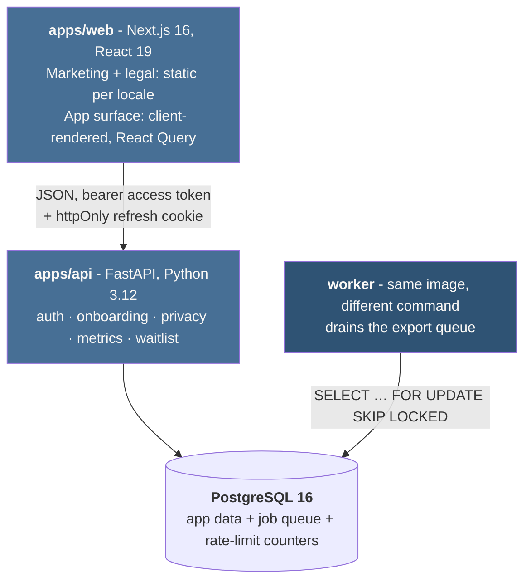

# Beff - Pre-Launch SaaS MVP

**Production intelligence for battery cell manufacturing.** See where yield is lost,
what it costs in scrap, and what it means for CO₂ per kWh.

Built as a technical take-home for Beff GmbH (Stuttgart). Not an official Beff product -
the domain is modelled on the problem space the company works in.

|              |                                                                                                                                                                 |
| ------------ | --------------------------------------------------------------------------------------------------------------------------------------------------------------- |
| **Live app** | <https://beff-eta.vercel.app>                                                                                                                                   |
| **API docs** | <https://http--beff-api--ygq2pkp2lvtn.code.run/docs>                                                                                                            |
| **Sign in**  | `demo@beff.example` / `beff-demo-password`                                                                                                                      |
| **Figma**    | [Beff - Design System & Product](https://www.figma.com/design/NmFvnuLBYD0FF9RvSVzl5Q/Beff-%E2%80%94-Design-System---Product?node-id=3-131&t=jhr51EMcotCPc5tk-1) |
| **Repo**     | <https://github.com/mohammadmaleh/beff-assignment>                                                                                                              |

The demo account has onboarding complete and sixty batches behind it, so the dashboard is
populated on first load. One process parameter is deliberately **out of spec** - a
dashboard where everything is green never demonstrates that it can show a problem.

---

## Run it

```bash
cp .env.example .env
docker compose up          # postgres + migrate + api + worker + web
```

Web → <http://localhost:3000> · API docs → <http://localhost:8000/docs>

Migrations and the demo seed run in a one-shot `migrate` service that gates the API, so
the stack comes up usable from an empty volume.

Without Docker:

```bash
pnpm install && pnpm dev                                           # frontend
cd apps/api && uv sync && uv run uvicorn beff.main:app --reload    # backend
```

## Look at the design system

```bash
pnpm storybook             # http://localhost:6006
```

21 stories across the component library - every state each component ships: default,
hover, focus-visible, active, disabled, loading, error, and both themes. The same
components are in Figma, pushed from the code with the tokens as Figma variables.

## Run the tests

```bash
# everything the CI runs
pnpm lint && pnpm typecheck && pnpm test && pnpm build
cd apps/api && uv run ruff check . && uv run mypy && uv run pytest --cov

# coverage reports
pnpm test                                  # every JS package, coverage printed per package
pnpm --filter @beff/ui test                # one package
cd apps/api && uv run pytest --cov --cov-report=term-missing

pnpm test:e2e                              # Playwright against the standalone build
pnpm test:a11y                             # axe-core, WCAG 2.2 AA, both locales
```

---

## Architecture

Monorepo, two deployables.



| Layer    | Stack                                                                                                      |
| -------- | ---------------------------------------------------------------------------------------------------------- |
| Frontend | Next.js 16, React 19, TypeScript 5.9, Tailwind 4, React Query, ECharts, next-intl-style typed dictionaries |
| Design   | Style Dictionary tokens → CSS + typed TS, Storybook 10, Figma variables                                    |
| Backend  | FastAPI, SQLAlchemy 2 async, Alembic, Pydantic v2, Argon2id                                                |
| Database | PostgreSQL 16 - application data **and** the job queue.                                    |
| Testing  | pytest + testcontainers, Vitest, Testing Library, Playwright, axe-core                                     |
| Tooling  | pnpm + Turborepo, uv, ruff, mypy strict, ESLint, GitHub Actions                                            |

```
apps/web              Next.js frontend          packages/ui           design system, subpath exports
apps/api              FastAPI backend           packages/tokens       design tokens + contrast gates
                                                packages/api-client   generated from OpenAPI
                                                packages/e2e          Playwright + axe
```

## What is in it

**Product**

- Landing, product and technology pages - statically generated, both locales, crawlable
- Dashboard: four headline KPIs, scrap breakdown **in process order** (a bar's position is
  economic information - a cell lost at formation has absorbed every upstream cost), yield
  trend, throughput, cost of position, control chart, and every parameter against its
  tolerance band
- Onboarding wizard - plant and line setup, progress persisted server-side after each
  step, so it resumes on any device
- Profile - consent, data export, account deletion
- Auth: register, email verification, login, silent refresh, logout
- Waiting list for signed-out visitors
- German and English, with `de.ts` typed against the English dictionary so a missing
  translation is a build error
